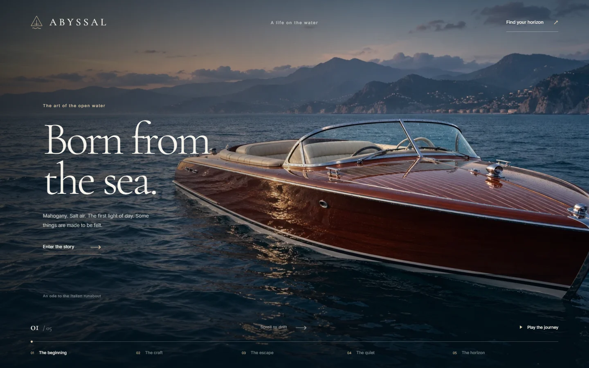
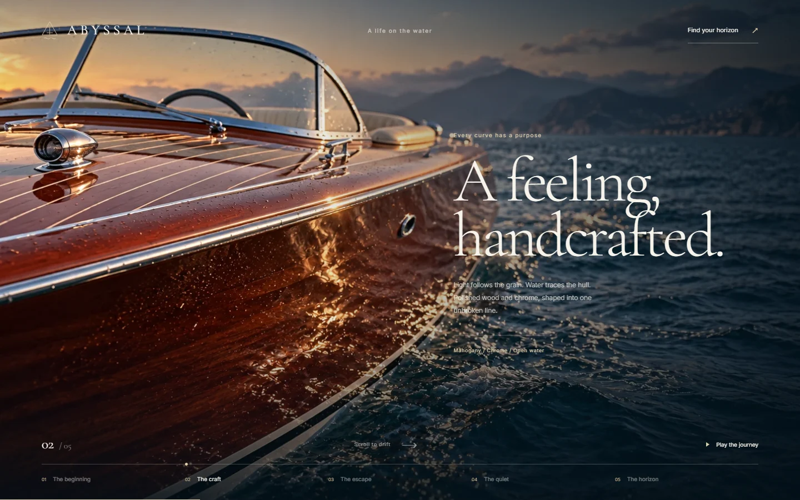
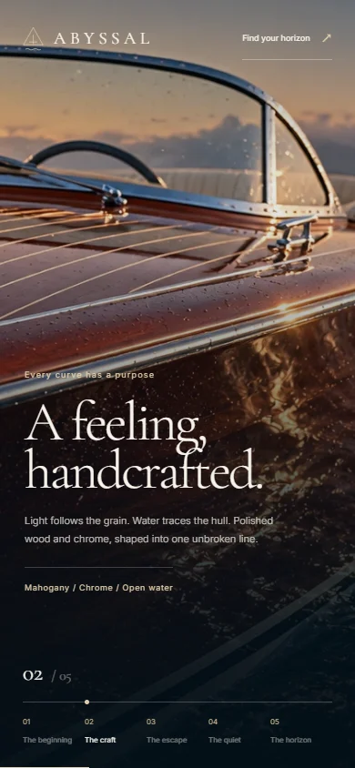

# ABYSSAL

### Born from the sea.

A cinematic web experience inspired by the classic Italian runabout. Five photographic chapters follow a mahogany boat from the first light on the Mediterranean to the open horizon, with the story unfolding through horizontal scrolling.



## The experience

- **Five connected chapters:** the beginning, the craft, the escape, the quiet, and the horizon.
- **Water-like transitions:** a custom WebGL compositor reveals each shot through a soft, refracted edge instead of a full-frame crossfade.
- **Scroll-driven cinematography:** subtle camera drift, coordinated text fades, and transitions that reverse as you scroll back.
- **Play the journey:** optional guided playback, with pause controls and automatic interruption on manual input.
- **Direct chapter navigation:** jump to any scene or replay the experience from the beginning.
- **Responsive framing:** image crops, typography, and controls adapt to smaller screens.
- **Progressive rendering:** photographic CSS reveals remain available while the compositor loads or if WebGL is unavailable. Reduced-motion preferences remove the camera drift and use direct shot changes.

This is an image-based cinematic sequence, rather than a video player or a live 3D boat simulation. The imagery is AI-generated for this concept; it does not represent an official boat listing or manufacturer specification.

## A closer look

The craftsmanship chapter brings the camera alongside the polished mahogany hull.



The mobile layout keeps the vessel in view and places the story above the chapter controls.



## Run locally

Requires **Node.js 20.9 or newer** and npm.

```bash
npm ci
npm run dev
```

Open [localhost:3000](http://localhost:3000).

No API keys or environment variables are required for the current experience. The scene images are served locally from `public/images/voyage/`. Next.js fetches the Inter and Cormorant Garamond fonts from Google during compilation, so the first build needs network access.

## Build and checks

```bash
# Create a production build
npm run build

# Serve the production build
npm start

# Run the repository linter
npm run lint

# Check TypeScript
npx tsc --noEmit
```

## Built with

- **Next.js 16 / React 19** — application structure and rendering.
- **TypeScript** — typed components and scene configuration.
- **GSAP ScrollTrigger** — pinned horizontal scrolling and shared journey progress.
- **Three.js / GLSL** — full-screen image compositing, refraction, and transition feathering.
- **Tailwind CSS 4 and custom CSS** — responsive layout, typography, and visual styling.
- **WebP imagery** — five locally served campaign images, approximately 1.45 MB combined.

## Project guide

```text
app/
  page.tsx                 Chapters, navigation, and playback controls
  layout.tsx               Fonts, metadata, and page shell
  globals.css              Visual design and responsive layouts
components/
  Navbar.tsx               Brand and final-chapter navigation
  HorizontalScroll.tsx     Pinned scroll timeline and text choreography
  CinematicScene.tsx       Image layers, renderer lifecycle, and CSS fallback
lib/
  voyage.ts                Chapter copy, image names, and navigation helper
  film-renderer.ts         WebGL compositor and transition shaders
  store.ts                 Shared scroll progress
public/images/voyage/      Optimized story imagery
docs/images/               Screenshots used in this README
```

The earlier 3D prototype remains in `components/Scene.tsx`; the current page uses `CinematicScene.tsx`.

## Make it your own

**Story and copy:** edit `lib/voyage.ts`. Each chapter defines its title, body, image, and text alignment. The current playback and chapter controls are tuned for five chapters; update their progress calculations if you change that count.

**Imagery:** replace the corresponding WebP files in `public/images/voyage/`. Use consistent boat details, lighting, and color across the sequence. The current images are approximately 16:9, with alternate mobile crops defined in the CSS fallback and the compositor's focus settings.

**Transitions:** adjust the reveal timing in `components/CinematicScene.tsx` and the feathering, refraction, and camera travel in `lib/film-renderer.ts`. Text timing lives in `components/HorizontalScroll.tsx`.

**Art direction:** edit `app/globals.css` for the ocean palette, typography, spacing, overlays, and mobile composition.
